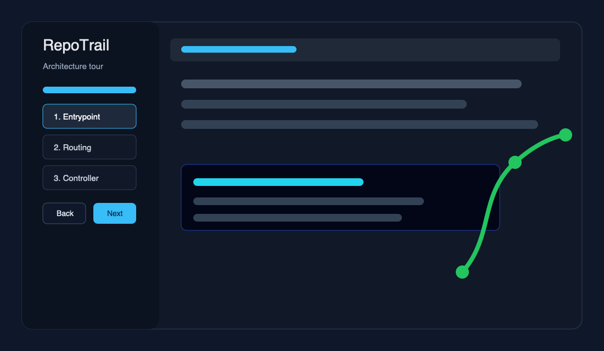

# RepoTrail

**Agent-guided codebase tours inside VS Code.**

RepoTrail turns a repo walkthrough JSON file into an editor-native route: your
agent writes `.repotrail/*.json`, RepoTrail opens native git-backed diffs for
change reviews or highlights tight ranges for codebase tours, shows narration,
and lets you move through the route with Back/Next, CodeLens, and the sidebar.



## How It Works

RepoTrail has one supported generation path: an external agent writes a complete
tour JSON file.

You can use it two ways:

1. Existing workspace: open one or more project roots in VS Code, then ask your
   agent to write `.repotrail/<tour>.json` in the owning project.
2. Agent-created workspace: ask your agent to check out the needed repos or
   worktrees, save a `.code-workspace` under `~/.repotrail/workspaces/`, open it
   in VS Code, and write the tour JSON into the owning project.

RepoTrail refreshes its sidebar library from the filesystem. Open the tour and
navigate locally in VS Code.

A tour can also travel in a GitHub pull request comment. Reviewers open it with
one link into any clone of the repository; see
[Share A Tour On A Pull Request](#share-a-tour-on-a-pull-request).

The extension does not ship a built-in LLM provider and does not send source
code to a hosted service by itself.

## Author A Tour In The Current Workspace

After installing the extension, open the target workspace in VS Code, open the
RepoTrail sidebar, and click **Agent setup**. Paste the copied prompt into your
agent.

You can also run this command:

```text
RepoTrail: Agent Setup
```

The copied prompt includes the complete `repo-trail` skill bundled with the
installed extension, the open workspace roots, the tour schema, the output
path, and the request to create the tour. Agents that support persistent skills
can install or update it as `repo-trail`; other agents can apply the embedded
instructions for that request. No separate download or extension server is
required. Existing integrations that invoke the 0.11.0
`repoTrail.copyTourPrompt` command ID receive the same prompt.

## Create A New RepoTrail Workspace

If you want the agent to set up the workspace too, install or paste the
[`repo-trail` skill](harness/repo-trail/SKILL.md) and ask:

```text
Use the repo-trail skill. Create a RepoTrail workspace for <repo or PR>. Check out any needed non-destructive worktrees, save the .code-workspace under ~/.repotrail/workspaces, open it in VS Code if possible, then write a RepoTrail JSON tour into the owning repo's .repotrail/ directory.
```

The global workspace directory is only a launch registry:

```text
~/.repotrail/workspaces/<workspace-slug>.code-workspace
~/.repotrail/workspaces/<workspace-slug>.manifest.json
```

Tours still live in the project that owns them:

```text
<project>/.repotrail/<tour>.json
```

## Tour JSON Files

Shared tours live in the repo that owns them:

```text
<project>/.repotrail/architecture.json
<project>/.repotrail/pr-walkthrough.json
```

RepoTrail accepts exported envelopes, stored records, and bare `TourPlan` JSON.
The preferred envelope is `repoTrailTour: 2` with `plan.roots` aliases and
per-step `root` values for multi-root tours. Older `workspaceFolder` steps still
work.

In a single-folder window, a tour that names one root (one alias, or one legacy
`workspaceFolder`) resolves it to the open folder when the name matches
nothing, so a tour written in `app-pr-12/` plays in a clone named `app/`. Tours
that name several roots, and multi-root windows, keep strict matching. A tour
imported from a pull request binds every stop to the clone it was imported
into.

A diff stop whose `baseRef` and `headRef` are commit SHAs doesn't depend on
what is checked out: RepoTrail uses the working-tree file only when it matches
`headRef`, and otherwise reads the file at `headRef` from git (for example a
file the change adds, in a clone on `main`).

## Share A Tour On A Pull Request

The author posts the tour as a fenced `json` block in a PR comment. Reviewers
click one link and RepoTrail loads the tour from GitHub into a clone they already
have. No agent is needed on the reviewer's side.

### Post a tour

Run `RepoTrail: Copy Tour as PR Comment`, pick the active tour or one from
`.repotrail/`, and enter the PR as `owner/repo#123` (prefilled from the folder's
GitHub remote). RepoTrail copies markdown to the clipboard. Paste it into a
comment on the PR; the extension never posts to GitHub itself. The comment has:

- a one-line intro;
- an **Open it in VS Code** link, plus the raw link for `code --open-url`;
- a collapsed setup prompt for reviewers without the extension or a clone,
  which has their coding agent check out the PR into a temporary directory,
  save the tour there, and open VS Code;
- a collapsed `json` block with the tour.

Before copying, RepoTrail removes local absolute paths from the tour and drops
captured anchors (reviewers capture their own). If the comment would pass
GitHub's 65,536-character limit, RepoTrail compacts the JSON, and if that is
still too long it refuses and says so. The setup prompt finds the comment by a
hidden marker, and only trusts comments from the PR's author or a collaborator.

### The review link

```text
vscode://repotrail.repotrail/review?pr=<owner>/<repo>/<number>[&comment=<id>][&head=<sha>]
```

- `pr` is required. Linking by PR means the link can be written before the
  comment exists; RepoTrail searches the PR's comments for tours.
- `comment` limits the search to one issue comment.
- `head` is the 40-character commit the tour was written for. Copy Tour as PR
  Comment sets it when every diff stop shares one `headRef`, and tours written
  for that head are preferred.

GitHub drops `vscode://` links from comments, so the clickable form goes through
`https://vscode.dev/redirect?url=<the link, URL-encoded>`, which redirects the
browser to the `vscode://` link. The handler accepts any scheme the editor
registers (`vscode`, `vscode-insiders`, ...); for other editors, change the
scheme and use their `--open-url`.

### Open a tour

From a link, or with `RepoTrail: Import Tour from GitHub PR` (paste a PR or
comment URL) or `RepoTrail: Find Tours on a PR` (the repo comes from the open
folder's remote; enter the number):

1. A link first shows VS Code's own "open this URI?" prompt, then RepoTrail's,
   which names the repository, PR, comment, and expected head. Nothing is
   requested before you confirm.
2. RepoTrail reads the PR and its issue comments from `api.github.com`. It uses
   your existing VS Code GitHub sign-in when there is one, tries anonymously
   otherwise, and offers to sign in when GitHub answers 401/404 or the anonymous
   rate limit runs out (private repositories need it).
3. A comment holds a tour when one of its fenced `json` blocks parses as a
   RepoTrail envelope (it has a `repoTrailTour` key). With several, pick one by
   title, poster, and date; tours from the PR's author and collaborators are
   listed first. Opening a tour posted by anyone else asks first, since anyone
   can comment on a public pull request.
4. RepoTrail uses an open folder whose git remote points at the PR's repository.
   With none open, it offers **Copy setup prompt** (the agent prompt above, for
   this PR and comment) or **Open Folder…**, which reopens the window on a clone
   and then offers to continue.
5. RepoTrail checks the commit SHAs the tour names (up to 64). If any are
   missing, it asks before running `git fetch --no-tags <remote> pull/<n>/head`,
   then fetches each SHA that is still missing. Nothing is checked out and no
   branch is created. If a fetch fails, RepoTrail says so and still opens the
   tour.
6. The tour plays from memory, with every stop bound to the chosen clone.
   **Save to .repotrail/** writes the comment's JSON into the clone; RepoTrail
   never saves it on its own.
7. RepoTrail warns when stops show a commit other than the PR's current head,
   compare against a base other than the PR's merge base, or compare against
   your working tree, and when the link's `head` is older than the PR's.

Comment JSON is only parsed as a tour. Nothing from a comment is run, step paths
go through the usual workspace-relative checks, refs must pass the same
validation as other git-backed stops, and tour text shown in notifications can't
form links.

## Features

- Full-route tours for architecture, PR/diff walkthroughs, file walkthroughs,
  request lifecycle traces, bug investigation paths, and design reviews.
- Slides: a stop can be a 16:9 slide with text, tables, code snippets,
  callouts, flow diagrams and sequence diagrams that build up in beats.
  Elements appear, change, get spotlighted, and send tokens along edges, with
  a caption and narration per beat. Slides and code stops share one editor
  column. Diagram nodes can open the file they describe, and nodes that
  consecutive slides share glide to their new places.
- Present mode hides the workbench chrome and shows captions; Play tour
  narrates each stop and beat and moves on by itself.
- Cross-repo tours in multi-root VS Code windows via `plan.roots` aliases or
  legacy per-step `workspaceFolder` addressing.
- Tight highlighted ranges with auto-captured anchors that detect code drift.
- Native git-backed full-file diff steps for PRs, commits, branch comparisons,
  and other change reviews. Highlight-only code stops stay available for
  codebase/subsystem tours unrelated to a change window.
- Cmd/Ctrl+click navigation inside diffs: the new side is the real workspace
  file when it matches what's checked out, and clicks on older revisions jump
  to the matching code or definition in the current file.
- Sidebar route list with seen-state dimming and current-step narration.
- Tour Files tree that shows the tour's files by folder, follows the current
  stop, and jumps to any file or stop on click.
- CodeLens controls above highlighted stops.
- Keyboard navigation with `Alt+Left` and `Alt+Right` (beats first on a
  slide; `Shift+Alt+Right` skips to the next stop). In a slide, the arrow
  keys, Space, PageUp/PageDown and presentation clickers work too; `P` plays
  or stops the tour and `Esc` leaves present mode.
- Optional narration via system speech, local Kokoro, macOS/Linux command TTS,
  ElevenLabs, or OpenAI TTS.
- Repository tour library backed by `.repotrail/*.json` across every open
  workspace root.
- PR review tours: copy a tour as a GitHub PR comment, and open one from a
  review link or a PR URL into any clone, fetching the PR's commits on request.
- Automatic reload when the active tour JSON changes, with the current stop
  preserved when possible.
- Agent-created VS Code workspace flow backed by
  `~/.repotrail/workspaces/*.code-workspace`.
- Export to Markdown, JSON, or standalone animated HTML with browser playback,
  embedded code/diff frames, and standalone TTS controls.
- Automatic restoration of a tour that was still active when VS Code closed.
  Stopping a tour prevents it from returning on the next reload.

## Security And Privacy

- RepoTrail has no local network listener. Tour authoring happens through files
  in `.repotrail/`.
- RepoTrail calls the network in two cases, both started by you: hosted TTS (see
  below), and reading a pull request and its comments from `api.github.com` when
  you open a review link or run an import command. There are no background or
  startup checks.
- RepoTrail reads git objects to render diffs. Its only git write is
  `git fetch --no-tags <remote> pull/<n>/head` (and still-missing tour commits) while
  importing a PR tour, and it asks first every time. It runs git through
  `execFile` with fixed arguments, never a shell.
- Review links are treated as untrusted. RepoTrail accepts only strict
  owner/repo, number, comment-id, and 40-character SHA values, and confirms the
  repository, PR, and comment before any request.
- Tour step files must be workspace-relative and cannot escape their selected
  workspace folder.
- Hosted TTS providers are opt-in and require your own API key. Keys are stored
  in VS Code SecretStorage; audio requests are made by the extension host, not
  the webview.
- RepoTrail itself does not collect telemetry.

See [PRIVACY.md](PRIVACY.md) for the longer policy.

## Commands

- `RepoTrail: Agent Setup` - copy workspace details and the JSON schema for your
  agent.
- `RepoTrail: Copy Tour From Here Prompt` - copy a prompt scoped to the active
  file or selection.
- `RepoTrail: Export Tour` - export Markdown, re-importable JSON, or a
  browser-playable animated HTML walkthrough.
- `RepoTrail: Import Tour` - open a one-off JSON file stored outside an open
  project's `.repotrail/` directory. Repo-local tours are discovered
  automatically.
- `RepoTrail: Import Tour from GitHub PR` - load a tour from a PR or comment URL
  into an open clone.
- `RepoTrail: Find Tours on a PR` - search a PR of the open folder's GitHub
  repository for tours.
- `RepoTrail: Copy Tour as PR Comment` - copy the markdown for a PR comment with
  the review link, an agent setup prompt, and the tour JSON.
- `RepoTrail: Rename Tour` - change the visible tour title without renaming
  the `.repotrail/*.json` file.
- `RepoTrail: Save Tour to Repo (.repotrail/)`.
- `RepoTrail: Manage TTS Credentials` - securely store, replace, or clear an
  OpenAI or ElevenLabs API key.
- `RepoTrail: Present Tour (Toggle)` - hide the side bars and panel and show
  slide captions; run it again, or press `Esc` in a slide, to leave.
- `RepoTrail: Play Tour (Toggle Autoplay)` - narrate the current stop or beat,
  then move on when it ends (after a reading pause when narration is off).
- `RepoTrail: Next Stop (Skip Slide Beats)`.

Agents can also run `node <extension>/out/cli.js lint <tour.json>` and
`render <tour.json> --out <file.html>`; see `harness/README.md`.

## Development

```bash
pnpm install
pnpm build
pnpm package
pnpm install-local
```

The primary validation gate is `pnpm build`. The packaged VSIX is installed
locally with `pnpm install-local`.

## Animated HTML Export

`RepoTrail: Export Tour` -> `Animated HTML (.html)` writes a standalone browser
player for the active tour. The file embeds the tour route, narration, bounded
code snapshots, and diff frames, so it can be opened outside VS Code or shared as
a single artifact.

Slides play in the export too, with their beats: Next and Back step through
them, and `<file>.html#stop=<n>&beat=<k>` opens any position. Markdown export
writes slide diagrams as Mermaid.

The exported player includes Back/Next, Play, Speak, and TTS settings. It carries
non-secret VS Code TTS defaults such as provider, model, and voice. API keys from
VS Code SecretStorage are not embedded; hosted OpenAI or ElevenLabs speech
requires entering a key in the browser, where it is stored only in that browser's
local storage. Command-based voices such as macOS `say` cannot run from a browser
page, so exports configured for Command narration start with System speech.

## Limitations

- RepoTrail plays tours; it does not generate them. Use an external agent or
  write the JSON file yourself.
- RepoTrail is read-only. It navigates and explains code; it does not refactor
  files. The only repository write is the confirmed PR fetch described above.
- PR tours work with github.com only, and RepoTrail looks for them in a pull
  request's issue comments (not the description or review comments). It doesn't
  clone repositories or check out the PR; open a clone first, or use the setup
  prompt. Remotes that use an SSH host alias (such as `git@github-work:org/repo`)
  aren't recognized as GitHub.
- Open VSX publishing is not currently part of the release flow.
