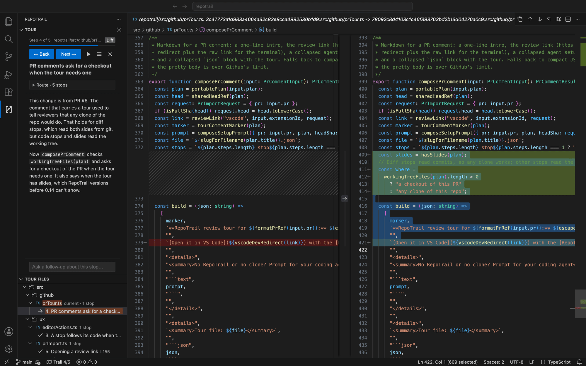
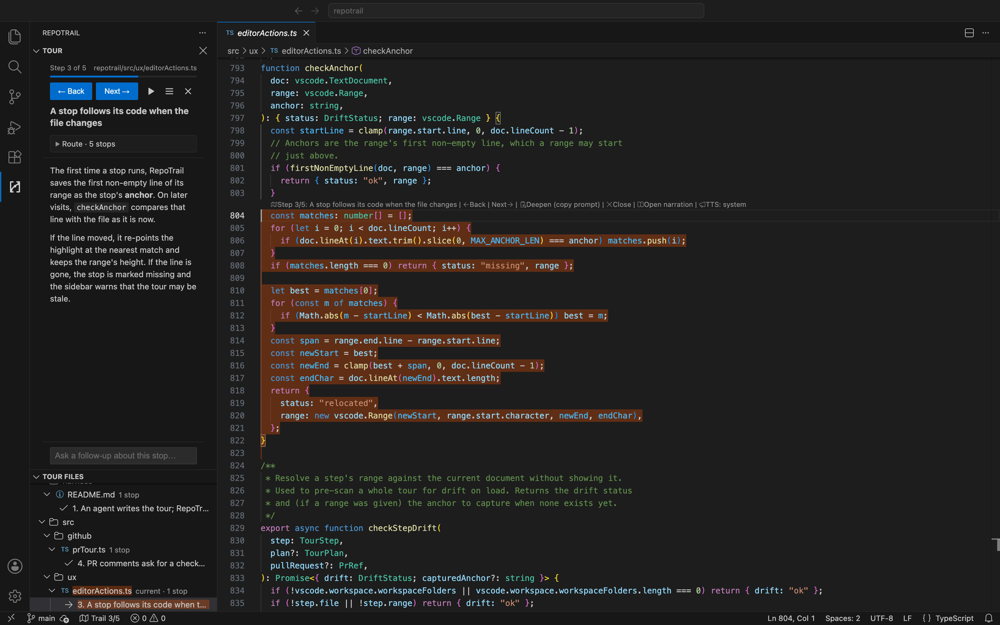
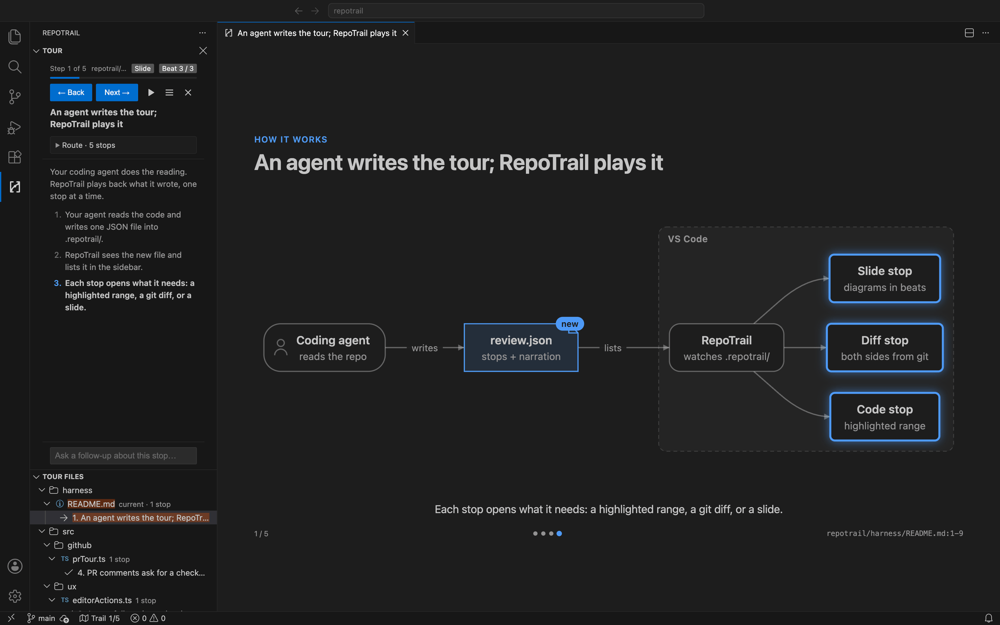

# RepoTrail

**Guided tours of your code, written by your coding agent, played in VS Code or as a page you can share.**

Ask your agent to walk you through a pull request, a subsystem, or a design
doc. It reads the code and writes a tour: an ordered list of stops, saved as a
JSON file in your repo's `.repotrail/` folder. RepoTrail plays that tour in the
editor. Each stop opens the real file with the important lines highlighted, a
native diff read from git, or an animated slide, and the agent's explanation
sits beside it in the sidebar. You step through with Back and Next.

No VS Code? In the Claude app or Claude Code, the RepoTrail plugin has Claude
render the same tour as a page and publish it as a Claude Artifact: a link
you can step through on any device and share. See
[Without VS Code](#without-vs-code).

RepoTrail works with any agent that can read your repo and write a file:
Claude Code, Codex, Cursor, or anything similar. The extension has no model of
its own and never uploads your source.



## What it's good for

- **Reviewing a pull request**, especially a large or agent-written one. Each
  stop is a real diff at the commits the PR names, in an order that explains
  the change instead of the alphabetical order of a file list.
- **Learning a codebase.** Architecture overviews, a request's path from the
  router to the database, the trail of a bug.
- **Design reviews.** A design doc or RFC becomes slides whose diagrams play
  out one step at a time and link to the code they describe.
- **Sharing what you learned.** A tour is a plain file. Commit it, post it on
  a PR so reviewers open it with one click, or export it as a standalone HTML
  page.

## Quick start

1. Install **RepoTrail** from the
   [VS Code Marketplace](https://marketplace.visualstudio.com/items?itemName=repotrail.repotrail),
   or from a terminal:

   ```bash
   code --install-extension repotrail.repotrail
   ```

2. Open your project and click the RepoTrail icon in the activity bar.
3. Click **Agent setup**. RepoTrail copies a prompt that contains its authoring
   skill, your open folders, and the tour format.
4. Paste the prompt into your agent and add what you want a tour of.
5. When the agent writes the file, the tour appears under **Repo tours**.
   Click **Open**.

Some requests to try:

```text
Walk me through the changes on this branch compared to main.
Give me a tour of how an HTTP request gets from the router to the database.
Turn docs/design/cache.md into a design review with slides.
```

If your agent supports persistent skills, it can save the bundled skill as
`repo-trail`. After that, "use the repo-trail skill" plus your request is
enough, without Agent setup.

### Without VS Code

In the Claude app's Code tab, claude.ai/code or the Claude Code CLI, install
the RepoTrail plugin. It carries the authoring skill:

```text
/plugin install repotrail --marketplace ilackarms/repotrail
```

On Claude Code older than 2.1.275, add the marketplace first:
`/plugin marketplace add ilackarms/repotrail`, then
`/plugin install repotrail@repotrail`.

Then ask for a tour as a page:

```text
Give me a RepoTrail tour of PR #42 as an Artifact.
Walk me through how this repo handles auth. Publish it as a page I can share.
```

Claude writes the tour to `.repotrail/` as usual, checks it with
`npx repotrail lint`, renders it with `npx repotrail render --artifact`, and
publishes the page as a Claude Artifact. The Artifact is private until you
share it. The page is plain HTML and SVG with no script: every stop on one
scrolling page, a contents list at the top, and light and dark themes.

- **Code stops** show the range with a dozen lines of context on each side.
- **Diff stops** show the change side by side, read from git, centered on
  the stop's range. Unchanged runs fold into "N unchanged lines" rows, and
  changes outside the range into "more changes above/below". On a phone they
  switch to one column.
- **Slides** are drawn as they stand after their last beat, with each beat's
  caption listed underneath. They don't animate.

The page is a snapshot. Code is copied in when it's rendered, so it can't
jump to the real file the way VS Code does. To update it, ask Claude to
change the tour, and it renders and republishes to the same link.

Any other agent with Node 18 or later can do the same without the plugin:

```bash
npx -y repotrail lint .repotrail/<tour>.json
npx -y repotrail render .repotrail/<tour>.json --artifact --out <tour>.html
```

Drop `--artifact` for the interactive player instead: one file that steps
through the tour with Back and Next, plays slide beats, and reads narration
aloud. It's bigger, because it carries its script.

## Three kinds of stops

Every stop has a title and a markdown explanation that shows in the sidebar.
What opens in the editor depends on the stop.

### Code

The file opens with a range highlighted. Use these for codebase tours, request
paths, and bug investigations.



The first time a stop runs, RepoTrail remembers the first line of its range.
If the code later moves, the highlight follows it and the stop notes that it
was re-anchored. If the code is gone, the stop warns that the tour may be
stale.

### Diff

The stop opens in VS Code's own diff editor. The left side is the file at the
stop's `baseRef`, read from git. The right side is the file at `headRef`, or
your working tree when the stop has no `headRef`. You see the whole file, so
imports and the code around a change are a scroll away.

- When the new side matches your checked-out file, the diff shows that file
  itself, so hover, Go to Definition, and Cmd/Ctrl+click work as usual. On an
  older revision, Cmd/Ctrl+click goes to the definition in the current file,
  or to the matching code when there isn't one.
- A stop whose refs are commit SHAs plays the same in any clone, whatever is
  checked out. RepoTrail shows your working-tree file only when it matches
  `headRef`, and otherwise reads the file from git. The exception is a PR
  you've checked out for review (see
  [Comment while you review](#comment-while-you-review)).

### Slide

The stop shows a 16:9 slide in a **RepoTrail Slides** tab, which shares the
editor column with code and diff stops. Slides hold text, bullets, tables,
short code snippets, callouts, flow diagrams (laid out for you), and sequence
diagrams.

Slides build up in **beats**. A beat can reveal or hide elements, change a
label or color, spotlight part of the slide, pulse an element, or send a token
along a diagram edge. Each beat has a short caption that can be read aloud.
Next walks through a slide's beats before moving to the next stop.



- Diagram nodes, sequence participants, and code blocks can name a file.
  Click one and the file opens beside the slide.
- When consecutive slides share a diagram node, it glides to its new position
  instead of the slide cutting over.
- A slide can name the doc section it summarizes; **Open source file** opens
  it.

Slides are for design docs and RFCs (tour kind `design-review`) and for the
big picture at the start of a PR tour.

## Taking a tour

The **Tour** view shows the current stop's explanation, Back and Next, and a
route list that dims the stops you've seen. The ☰ menu holds the rest:
jump to the stop's code, open its source file, comment on the PR, copy a
deepen prompt, export, present, play, narration settings, close, and delete.

Around the editor:

- **Tour Files** lists the tour's files as a folder tree with stop counts,
  follows the current stop, and jumps to any file or stop you click.
- **CodeLens** above a code stop shows its title and number, Back, Next,
  Deepen, Close, Open narration, and the narration provider. Other stops in
  the same file get a marker you can click.
- The **status bar** shows `Trail 3/12` while a tour is open.

### Keyboard

| Keys | Does |
| --- | --- |
| `Alt+→` / `Alt+←` | Next / previous step. On a slide, beats come first. |
| `Shift+Alt+→` | Next stop, skipping the rest of the slide's beats. |
| `Cmd+Alt+O` (macOS), `Alt+O` | Open the current stop's source file. |
| `←`, `→`, `Space`, `PageUp`, `PageDown` | Move through the tour while a slide has focus. Presentation clickers work too. |
| `P` | Play or stop the tour (slide focused). |
| `Esc` | Leave present mode (slide focused). |

On macOS, `Alt` is the Option key.

### Present and play

- **Present** (`RepoTrail: Present Tour (Toggle)`) hides the side bars and
  panel and turns on slide captions. Run it again, or press `Esc` in a slide,
  to leave.
- **Play** (`RepoTrail: Play Tour (Toggle Autoplay)`) narrates each stop and
  beat and moves on when the narration ends, or after a reading pause when
  narration is off. Move by hand at any time and it carries on from there.

### Asking for more

RepoTrail doesn't talk to your agent. It writes prompts for you to paste:

- **Ask a follow-up about this stop…** at the bottom of the panel copies your
  question with the stop's title and file, and asks the agent to add a
  clarifying stop if the answer belongs in the tour.
- **Copy deepen prompt** (☰ menu, or the Deepen CodeLens) asks the agent to
  add 2–4 focused stops after the current one.
- **Copy Tour From Here Prompt** in the editor's context menu asks for a new
  tour that starts at the selected code.
- **Copy Selection Reference** (`Cmd+Alt+C` / `Ctrl+Alt+C`) copies
  `path:start-end` and the selected lines as a fenced code block, handy for
  pointing an agent at code.

When the agent edits the tour file, RepoTrail reloads it and keeps your place
when it can.

The tour you had open comes back after you reload VS Code. Closing it with ×
keeps it closed.

## Narration

Narration never starts by itself. Click ▶ in the toolbar to hear the current
stop, or use Play to narrate the whole tour. Pick a voice in
**Narration settings…** (☰ menu) or with `repoTrail.tts.provider`.

| Provider | Value | Notes |
| --- | --- | --- |
| System | `system` | The default. Your OS voices through the browser's speech engine. Free and offline. |
| Kokoro | `kokoro` | A local neural voice (Kokoro-82M) that runs in the sidebar. Downloads the model on first use. Choose a voice with `repoTrail.tts.kokoroVoice`. |
| Command | `say` | Runs a local program such as macOS `say`, `espeak`, or `spd-say` with the narration as one argument. |
| OpenAI | `openai` | Hosted. Needs your API key. |
| ElevenLabs | `elevenlabs` | Hosted. Needs your API key. |
| Off | `off` | No narration. |

Store hosted keys with **RepoTrail: Manage TTS Credentials**, which keeps them
in VS Code's SecretStorage rather than `settings.json`. `OPENAI_API_KEY` and
`ELEVENLABS_API_KEY` in the environment work too.

## Tour files

Tours live in the project they describe:

```text
<project>/.repotrail/<name>.json
```

RepoTrail lists the tours in every open folder and notices new, changed, and
deleted files as they happen, including a whole `.repotrail/` folder appearing
or disappearing. While RepoTrail is installed, VS Code validates
`.repotrail/*.json` against the [tour schema](harness/tour.schema.json).

A small tour with one code stop and one diff stop:

```json
{
  "repoTrailTour": 2,
  "plan": {
    "kind": "pr-diff",
    "title": "Validate orders before they're saved",
    "summary": "The order handler now rejects bad input before it reaches the database.",
    "steps": [
      {
        "title": "Orders enter through one route",
        "file": "src/routes.ts",
        "range": { "startLine": 14, "endLine": 22 },
        "viewMode": "code",
        "explanation": "Every order write goes through `POST /orders`, so validating here covers all callers."
      },
      {
        "title": "The handler validates first",
        "file": "src/handlers/orders.ts",
        "range": { "startLine": 31, "endLine": 48 },
        "viewMode": "diff",
        "diff": { "baseRef": "main", "scope": "file" },
        "explanation": "The schema check moved ahead of the insert. A bad request now gets a 400 instead of a constraint error from the database."
      }
    ]
  }
}
```

The fields you'll see most:

| Field | Meaning |
| --- | --- |
| `plan.kind` | `architecture`, `pr-diff`, `file-walkthrough`, `request-lifecycle`, `bug-investigation`, or `design-review`. |
| `step.title`, `step.explanation` | The stop's headline and its markdown narration. |
| `step.file`, `step.range` | A workspace-relative path, and the lines to highlight: `startLine` through `endLine`, both included, 1-indexed. |
| `step.viewMode` | `code` to highlight, `diff` to compare. |
| `step.diff` | `baseRef`, optional `headRef` (leave it out to compare against your working tree), `scope: "file"`, and `baseFile` / `headFile` for renames. |
| `step.slide` | Makes the stop a slide. |
| `plan.roots`, `step.root` | Aliases for tours that span several folders in a multi-root window. |

In a single-folder window, a tour that names one root plays in whatever folder
is open, so a tour written in `app-pr-12/` still works in a clone called
`app/`. Tours that name several roots, and multi-root windows, match roots by
`name` or `pathHint`. RepoTrail also reads a bare `plan` object without the
envelope, and older tours that use `workspaceFolder` instead of `root`.

The full format, including slides and beats, is in the
[authoring skill](harness/repo-trail/SKILL.md). The
[harness contract](harness/README.md) covers what agents can rely on.

RepoTrail keeps its own copy of each tour you open, with your place in it,
under `~/.repotrail/tours/`, outside the repo.

## Sharing tours

- **Commit them.** Anyone with RepoTrail who opens the repo sees the tour in
  their library.
- **Post one on a pull request.** Reviewers open it from a link. See the next
  section.
- **Publish one as a page.** `npx repotrail render --artifact` writes a small
  page to publish as a Claude Artifact, for readers without VS Code. See
  [Without VS Code](#without-vs-code).
- **Export one.** **Export tour…** writes:
  - **Animated HTML**: a single-file player with the code, diffs, slides, and
    beats, plus Back, Next, and a Speak button with its own voice settings.
    Add `#stop=<n>&beat=<k>` to the URL to open any position.
  - **Markdown**, with slide diagrams as Mermaid, which GitHub renders.
  - **JSON** that RepoTrail can import again.

  Exports carry your narration settings but never your API keys. A hosted
  voice in an HTML export asks for a key in the browser and keeps it in that
  browser's local storage. Command voices can't run in a browser, so those
  exports start with System speech.

## Pull request tours

A tour can travel inside a PR comment. Reviewers click a link and the tour
opens in a clone they already have. They don't need an agent.

### Post a tour

1. Run **RepoTrail: Copy Tour as PR Comment**, pick the tour, and enter the PR
   as `owner/repo#123` (prefilled from your git remote).
2. Paste the copied markdown as a comment on the PR. RepoTrail never posts to
   GitHub itself.

The comment contains an **Open it in VS Code** link, the raw link for
`code --open-url`, a collapsed setup prompt for reviewers who don't have the
extension or a clone (it has their agent check out the PR and open the tour),
and the tour JSON, collapsed.

Before copying, RepoTrail strips local absolute paths and captured anchors.
If the comment would pass GitHub's 65,536-character limit it switches to
compact JSON, and if that's still too long it tells you.

For a tour that plays in anyone's clone, pin every diff stop's `baseRef` to
the PR's merge base and `headRef` to its head, as full commit SHAs. The skill
does this when it writes a PR tour.

### Open a tour

Click the comment's link, or run **RepoTrail: Import Tour from GitHub PR**
(paste a PR or comment URL) or **RepoTrail: Find Tours on a PR**. Then:

1. **A link asks first.** RepoTrail names the repository, PR, and comment, and
   requests nothing until you agree. The commands start from the PR you
   enter.
2. **It reads the PR** and its comments from `api.github.com`, using your VS
   Code GitHub sign-in if you have one. Private repositories need it.
3. **You pick a tour** if the PR has several. Tours from the PR's author and
   collaborators are listed first, and opening anyone else's asks again.
4. **It picks your clone**: an open folder whose remote is the PR's
   repository, preferring one checked out at the PR's head. If the tour reads
   working-tree files and they differ from the PR's head, it names them and
   offers the worktree that has the head checked out, another folder, or
   loading here anyway. With no clone open, it offers **Open Folder…** or
   **Copy setup prompt**.
5. **It fetches only with permission.** If commits the tour names are missing,
   it asks before running `git fetch --no-tags <remote> pull/<n>/head`.
   Nothing is checked out.
6. **Nothing is written to your repo.** **Save to .repotrail/** adds the
   tour there; RepoTrail never does that on its own.
7. **It flags mismatches**: stops that don't show the PR's current head or
   merge base, stops that compare against your working tree, and a link whose
   head isn't the PR's current head.

VS Code sends a link to the window you used last, which may not be the one
with your clone. Pick the right folder from RepoTrail's prompt and the import
continues in the window that has it open.

If an import stops without explanation, **Output ▸ RepoTrail** shows where
(`[pr-import] stopped: …`).

The link format, for tools that build their own comments:

```text
vscode://repotrail.repotrail/review?pr=<owner>/<repo>/<number>[&comment=<id>][&head=<sha>]
```

GitHub removes `vscode://` links from comments, so the clickable version goes
through `https://vscode.dev/redirect?url=<the link, URL-encoded>`. The link
works with any scheme the editor registers, such as `vscode-insiders://`. For
other editors built on VS Code, swap in their scheme and use their
`--open-url`.

### Comment while you review

RepoTrail doesn't post review comments. The
[GitHub Pull Requests](https://marketplace.visualstudio.com/items?itemName=GitHub.vscode-pull-request-github)
extension does, and it only puts its `+` comment gutter on the files of a PR
it has checked out. So:

- When GitHub Pull Requests has the tour's PR checked out, diff stops use your
  checked-out file as the new side, and the `+` gutter works inside the tour.
- **Comment on PR…** in the ☰ menu (on tours with diffs) reopens the stop on
  the checked-out file. If the PR isn't checked out, it offers to check it
  out through GitHub Pull Requests and reopens the stop once the checkout
  lands. For a tour imported from a PR, it also offers **Comment on GitHub**,
  which opens the PR's changed files at this stop's file. If the extension
  isn't installed, it offers to install it.

GitHub takes comments only on lines the PR changes, on the new side of the
diff. Diff stops built from inline text or scoped to a hunk have no comment
gutter; for those, Comment on PR opens the file itself.

## For agents and tool builders

- **[`harness/repo-trail/SKILL.md`](harness/repo-trail/SKILL.md)** is the
  authoring guide: choosing stops, diffs versus highlights, slides and beats,
  and PR comments. The extension ships it, and Agent setup pastes the
  installed copy, so the instructions always match the version you have.
- **[`harness/README.md`](harness/README.md)** is the file contract.
- **[`harness/tour.schema.json`](harness/tour.schema.json)** is the JSON
  Schema (draft-07).
- **The `repotrail` command line** lints and renders tours. It ships two ways:
  as the [`repotrail`](https://www.npmjs.com/package/repotrail) npm package,
  and as `out/cli.js` inside the extension. Agent setup includes the
  extension's full path.

  ```bash
  npx -y repotrail lint <tour.json> [--root <dir> | --root <alias>=<dir>]... [--json]
  npx -y repotrail render <tour.json> --out <file.html> [--artifact] [--root ...]...
  node <extension>/out/cli.js lint <tour.json>
  ```

  `lint` checks the schema, beat ids, that every file and range exists, and
  the skill's text budgets, and exits 1 on errors. `render` writes the same
  HTML player as Export. With `--artifact`, it writes a static page (HTML
  and SVG, no script) to publish as a Claude Artifact.
- **The Claude Code plugin** in [`harness/`](harness/) installs the skill
  with `/plugin install repotrail --marketplace ilackarms/repotrail`.

An agent can also set up the workspace. Ask it to check out the repos or
worktrees it needs, save a `.code-workspace` under `~/.repotrail/workspaces/`,
open it in VS Code, and write the tour into the owning project's
`.repotrail/`:

```text
Use the repo-trail skill. Create a RepoTrail workspace for <repo or PR>. Check out any needed non-destructive worktrees, save the .code-workspace under ~/.repotrail/workspaces, open it in VS Code if possible, then write a RepoTrail JSON tour into the owning repo's .repotrail/ directory.
```

## Commands

| Command | Does |
| --- | --- |
| **Getting a tour** | |
| `RepoTrail: Agent Setup` | Copy the authoring prompt for your agent. |
| `RepoTrail: Copy Tour From Here Prompt` | Copy a prompt for a tour that starts at the current selection or file. |
| `RepoTrail: Copy Selection Reference` | Copy `path:lines` and the selected code. |
| `RepoTrail: Import Tour` | Open a tour file from outside `.repotrail/`. |
| `RepoTrail: Import Tour from GitHub PR` | Load a tour from a PR or comment URL. |
| `RepoTrail: Find Tours on a PR` | Search a PR of this repository for tours. |
| **Moving around** | |
| `RepoTrail: Next Step` / `Previous Step` | Step forward or back, beats included. |
| `RepoTrail: Next Stop (Skip Slide Beats)` | Jump to the next stop. |
| `RepoTrail: Jump to Current Step Code` | Bring the current stop's code back into view. |
| `RepoTrail: Open Current Step Source` | Open the stop's file as a normal editor. |
| `RepoTrail: Present Tour (Toggle)` | Hide the side bars and panel and show slide captions. |
| `RepoTrail: Play Tour (Toggle Autoplay)` | Narrate and advance on its own. |
| **Working with a tour** | |
| `RepoTrail: Go Deeper` | Copy a prompt to expand the current stop. |
| `RepoTrail: Comment on PR` | Reopen this stop where GitHub Pull Requests can take a comment, or open it on github.com. |
| `RepoTrail: Copy Tour as PR Comment` | Copy a PR comment that carries the tour. |
| `RepoTrail: Export Tour` | Export HTML, Markdown, or JSON. |
| `RepoTrail: Save Tour to Repo (.repotrail/)` | Save an imported tour into the project. |
| `RepoTrail: Rename Tour` | Change the tour's title (the file name stays). |
| `RepoTrail: Close Tour` | Close the tour. Saved tours stay in the library. |
| `RepoTrail: Delete Tour…` | Move a tour file to the trash and forget your progress. |
| **Narration** | |
| `RepoTrail: Speak Current Step` / `Stop Speech` | Start or stop narration. |
| `RepoTrail: Cycle TTS Mode` | Switch to the next narration provider. |
| `RepoTrail: Manage TTS Credentials` | Save, replace, or clear an OpenAI or ElevenLabs key. |

## Settings

| Setting | Default | |
| --- | --- | --- |
| `repoTrail.slides.motion` | `full` | How beats animate: `full`, `reduced` (fades only, also used when your OS asks for reduced motion), or `off`. |
| `repoTrail.slides.captions` | `true` | Show each beat's narration as a caption on the slide. |
| `repoTrail.tts.provider` | `system` | Narration engine. See [Narration](#narration). |
| `repoTrail.tts.kokoroVoice` | `af_heart` | Voice for Kokoro. |
| `repoTrail.tts.command` | `say` | Program for the Command provider. |
| `repoTrail.tts.openAiModel` | `gpt-4o-mini-tts` | OpenAI speech model. |
| `repoTrail.tts.openAiVoice` | `ash` | OpenAI voice. |
| `repoTrail.tts.openAiInstructions` | (a friendly pair-programming tone) | Tone instructions for steerable OpenAI models. |
| `repoTrail.tts.elevenLabsVoiceId` | `21m00Tcm4TlvDq8ikWAM` | ElevenLabs voice. |
| `repoTrail.tts.elevenLabsModel` | `eleven_flash_v2_5` | ElevenLabs model. |

## Privacy and security

- **No telemetry**, and no local server or open port.
- **Goes online only for things you start.** Opening a PR tour reads the PR
  and its comments from `api.github.com`, plus the `git fetch` you approve.
  A hosted voice sends narration text to OpenAI or ElevenLabs. The Kokoro
  voice downloads its library and model from public CDNs and Hugging Face.
  RepoTrail runs no startup or background checks of its own.
- **The command line stays offline.** It reads the tour, the files it names
  and git objects, and writes one HTML file. `npx` downloads it from npm. A
  page rendered with `--artifact` loads nothing when opened, but it holds
  excerpts of your code, so share it as you would the code.
- **Never posts to GitHub.** To tell whether a diff stop can take comments,
  RepoTrail asks the GitHub Pull Requests extension, if you have it, which PR
  a folder has checked out, passing only the folder. Asking can start that
  extension, which talks to GitHub on its own.
- **Writes to git only with permission.** RepoTrail reads git objects to draw
  diffs. Its only git write is the PR fetch above, and it asks every time. Git
  runs through `execFile` with fixed arguments, never a shell.
- **Treats links and comments as untrusted.** Review links accept only strict
  owner, repo, number, comment id, and 40-character SHA values. Comment JSON
  is parsed as a tour and nothing else. Step paths must stay inside their
  workspace folder, and tour text shown in notifications can't become a link.
- **Keeps keys out of settings.** Hosted TTS keys live in SecretStorage, and
  audio requests come from the extension host, not the webview.

The full policy is in [PRIVACY.md](PRIVACY.md).

## Limitations

- RepoTrail plays tours but doesn't write them. Your agent does, or you can
  write the JSON by hand.
- It doesn't edit your code. It writes only tour files in `.repotrail/`, when
  you save, rename, or delete a tour, and fetches a PR's commits when you
  approve.
- PR tours work with github.com only, and RepoTrail looks for them in a PR's
  conversation comments, not its description or review comments. It doesn't
  clone repositories. Remotes that use an SSH host alias (such as
  `git@github-work:org/repo`) aren't recognized as GitHub.
- RepoTrail isn't published to Open VSX yet.
- Requires VS Code 1.85 or later.

## Development

```bash
pnpm install
pnpm build          # typecheck and bundle; the main check
pnpm test           # unit tests
pnpm package        # build a .vsix
pnpm install-local  # package and install it into VS Code
```

[AGENTS.md](AGENTS.md) describes how the source is layered.
`node scripts/preview-slides.mjs <tour.json>` renders a tour's slides to one
HTML page for checking visuals without VS Code (run `pnpm compile` first).

[Changelog](CHANGELOG.md) · [Support](SUPPORT.md) · [Privacy](PRIVACY.md) ·
[MIT License](LICENSE)
